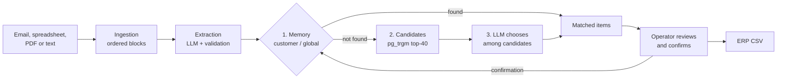

# Cotador

Cotador turns a quote request received by email (text, `.eml`, `.msg`, spreadsheet, PDF) into items matched
against the product catalog and a CSV ready to import into the ERP. The operator reviews what the system
suggested, corrects whatever is needed, and each correction becomes memory for future quotes.

> Portfolio version. This repository is a portfolio sample of a system running in production for a client; here
> brand and data are fictional ("Nexo Distribuição", an invented technology distributor), and the full production
> code is private by contract.

## Why it exists

B2B distributors receive dozens of quote requests a day, each in its own format: a table inside the email
body, an attached spreadsheet, a PDF, a list written as continuous text, a reply chain with the request buried in the
middle. Someone reads all of it, looks up each item in the catalog, and types the proposal into the ERP. It is
slow, and the most expensive mistake is a silent one: a 24-port switch instead of a 48-port one, Cat5e cable
instead of Cat6.

Cotador automates the reading and the search, but the operator has the last word: the system suggests and
records, and never decides on its own.

## How it works



1. **Ingestion** (`app/ingestao`): any input becomes an ordered list of `texto | tabela | anexo` blocks.
   Data tables are separated from layout tables (the signature), quotations of earlier replies are marked,
   repeated attachments are discarded by hash, signature images are ignored, and an unreadable attachment
   becomes a warning, not an error.
2. **Extraction** (`app/extracao`): the model returns the customer, CNPJ (Brazilian company registration number),
   destination, and items with a verbatim `descricao_original`. The response is validated with pydantic, there
   is one retry when the JSON is invalid, and results are cached by a hash of the content.
3. **Matching** (`app/matching`): memory, then trigram candidates, then the model choosing among the
   candidates. Divergent critical attributes (ports, cable category, voltage, gauge...) remove the candidate
   before the model sees it. See [ADR 0001](docs/adr/0001-three-layers-before-calling-the-language-model.md).
4. **Export** (`app/exportacao`): a 45-column CSV, UTF-8 with BOM, CRLF, `,` separator (decimal comma inside
   quotes). The invariants are tested, including a golden file. See [ADR 0003](docs/adr/0003-erp-csv-invariants-tested-byte-for-byte.md).
   (The layout follows the proposal-import layout of ERPs such as Tiny ERP.)

## Stack

Python 3.12, FastAPI, pydantic v2, psycopg 3, PostgreSQL 16 with `pg_trgm` (GiST index), pdfplumber, openpyxl,
extract-msg, httpx. Front end in React 18 + Vite + TypeScript. Tests with pytest and Vitest; lint with ruff and
ESLint; CI on GitHub Actions with a real Postgres.

## How to run

With Docker:

```bash
docker compose up --build
# interface: http://localhost:8080   API: http://localhost:8000/docs
```

The database comes up with the schema and 41 fictional products. By default `LLM_API_URL=demo`, a demonstration
provider (a simple rule, no model) that reads lines such as `4x switch 24 portas gigabit`. To use a real model,
copy `.env.example` to `.env` and fill in `LLM_API_URL`, `LLM_API_KEY` and `LLM_MODEL`: any chat API in the
OpenAI format works, with no code changes.

Without Docker:

```bash
python -m venv .venv && . .venv/bin/activate
pip install -e ".[dev]"
LLM_API_URL=demo uvicorn app.main:criar_app_do_ambiente --factory   # without DATABASE_URL, uses the in-memory catalog
cd web && npm ci && npm run dev                                      # http://localhost:5173
```

Tests and checks:

```bash
ruff check . && ruff format --check .
pytest                                  # database tests run if TEST_DATABASE_URL points to a Postgres with pg_trgm
python scripts/avaliar_recall.py        # recall@k of the candidate generator
cd web && npx tsc --noEmit && npx eslint . && npx vitest run && npx vite build
```

## Structure

| Path | Contents |
|---|---|
| `app/ingestao/` | email (`.eml`, `.msg`), HTML, spreadsheet, CSV, PDF into canonical blocks |
| `app/extracao/` | `ProvedorLLM` port, HTTP adapter, fake, extractor with cache and retry |
| `app/matching/` | memory, scorer, critical attributes, batch selector, three-layer engine |
| `app/exportacao/` | ERP CSV, CNPJ validation, price formatting |
| `app/api/` | FastAPI routes, use cases, repositories (Postgres and in-memory) |
| `app/main.py` | application factory, with injectable repository and provider |
| `db/` | migration, example catalog (`catalogo.csv`), `seed.sql` generated from it, evaluation cases |
| `scripts/` | `avaliar_recall.py`, `gerar_seed.py` |
| `web/` | single screen: paste/send, editable table, generate CSV |
| `docs/adr/` | architecture decisions |

## API

| Method and route | Purpose |
|---|---|
| `POST /propostas/extrair` | multipart with `texto` and/or `arquivo`; reads, matches, and saves the proposal |
| `GET /propostas/{id}` | proposal with items, candidates, and confidence |
| `PUT /propostas/{id}/itens/{n}` | chooses product, quantity, or price; choosing a product writes it to memory |
| `POST /propostas/{id}/csv` | generates the import CSV |
| `GET /produtos?q=` | searches the catalog by text or code |

## Decisions and limits

- Suggested price = catalog cost + a fixed margin (`MARGEM_PADRAO_PCT`, 30 by default), editable per item. A
  per-customer price table is out of scope.
- `scripts/avaliar_recall.py` measures layer 2 recall@k on `db/avaliacao.csv`. The example catalog has 41
  products, so recall@40 is high by construction; the script prints the catalog size so that stays explicit.
  Run it on your catalog before trusting the number.
- The model chooses only among candidates; the confidence it reports is its own claim, not a calibrated
  probability.
- `.msg` uses `extract-msg` and has no synthetic fixture in the tests (the format is binary); `.eml`, CSV, XLSX
  and PDF do.
- No authentication: intended to run behind the company network or a proxy.
