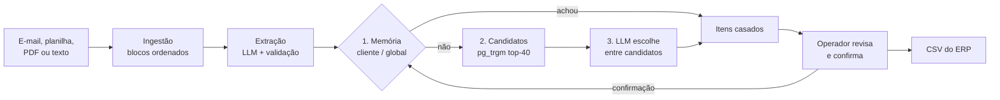

# Cotador

Transforma um pedido de cotação recebido por e-mail (texto, `.eml`, `.msg`, planilha, PDF) em itens casados com o
catálogo de produtos e num CSV pronto para importar no ERP. O operador revisa o que o sistema sugeriu, corrige o que
precisar, e cada correção vira memória para as próximas cotações.

> Versão de portfólio. O sistema roda em produção para um cliente; aqui marca e dados são fictícios ("Nexo
> Distribuição", uma distribuidora de tecnologia inventada), e o código em produção é privado por contrato.

## Por que existe

Distribuidoras B2B recebem dezenas de pedidos de cotação por dia, cada um num formato: tabela dentro do corpo do
e-mail, planilha anexa, PDF, lista em texto corrido, corrente de respostas com o pedido enterrado no meio. Alguém
lê tudo, procura cada item no catálogo e digita a proposta no ERP. É lento e o erro mais caro é silencioso:
um switch de 24 portas no lugar de um de 48, cabo Cat5e no lugar de Cat6.

O Cotador automatiza a leitura e a busca, mas mantém o operador como última palavra: o sistema sugere e registra,
nunca decide sozinho.

## Como funciona



1. **Ingestão** (`app/ingestao`): qualquer entrada vira uma lista ordenada de blocos `texto | tabela | anexo`.
   Tabelas de dados são separadas de tabelas de layout (assinatura), citações de respostas anteriores são marcadas,
   anexos repetidos são descartados por hash, imagens de assinatura são ignoradas e anexo ilegível vira aviso, não erro.
2. **Extração** (`app/extracao`): o modelo devolve cliente, CNPJ, destino e itens com `descricao_original` literal.
   Resposta validada com pydantic, uma nova tentativa em caso de JSON inválido, cache por hash do conteúdo.
3. **Casamento** (`app/matching`): memória, depois candidatos por trigramas, depois o modelo escolhendo entre os
   candidatos. Atributos críticos divergentes (portas, categoria do cabo, tensão, bitola...) retiram o candidato
   antes de o modelo vê-lo. Ver [ADR 0001](docs/adr/0001-tres-camadas-antes-do-modelo.md).
4. **Exportação** (`app/exportacao`): CSV de 45 colunas, UTF-8 com BOM, CRLF, separador `,` (vírgula decimal entre aspas). Os invariantes
   são testados, incluindo um arquivo golden. Ver [ADR 0003](docs/adr/0003-invariantes-do-csv-testados.md).
   (O layout segue o de importação de propostas de ERPs como o ERP Tiny.)

## Stack

Python 3.12, FastAPI, pydantic v2, psycopg 3, PostgreSQL 16 com `pg_trgm` (índice GiST), pdfplumber, openpyxl,
extract-msg, httpx. Front-end em React 18 + Vite + TypeScript. Testes com pytest e Vitest; lint com ruff e ESLint;
CI no GitHub Actions com Postgres de verdade.

## Como rodar

Com Docker:

```bash
docker compose up --build
# interface: http://localhost:8080   API: http://localhost:8000/docs
```

O banco sobe com o esquema e 41 produtos fictícios. Por padrão `LLM_API_URL=demo`, um provedor de demonstração
(regra simples, sem modelo) que lê linhas como `4x switch 24 portas gigabit`. Para usar um modelo de verdade,
copie `.env.example` para `.env` e preencha `LLM_API_URL`, `LLM_API_KEY` e `LLM_MODEL`: qualquer API de chat no
formato OpenAI funciona, sem mudar código.

Sem Docker:

```bash
python -m venv .venv && . .venv/bin/activate
pip install -e ".[dev]"
LLM_API_URL=demo uvicorn app.main:criar_app_do_ambiente --factory   # sem DATABASE_URL usa o catálogo em memória
cd web && npm ci && npm run dev                                      # http://localhost:5173
```

Testes e verificações:

```bash
ruff check . && ruff format --check .
pytest                                  # testes de banco rodam se TEST_DATABASE_URL apontar para um Postgres com pg_trgm
python scripts/avaliar_recall.py        # recall@k do gerador de candidatos
cd web && npx tsc --noEmit && npx eslint . && npx vitest run && npx vite build
```

## Estrutura

| Caminho | O que tem |
|---|---|
| `app/ingestao/` | e-mail (`.eml`, `.msg`), HTML, planilha, CSV, PDF para blocos canônicos |
| `app/extracao/` | porta `ProvedorLLM`, adaptador HTTP, fake, extrator com cache e nova tentativa |
| `app/matching/` | memória, scorer, atributos críticos, seletor em lotes, motor das três camadas |
| `app/exportacao/` | CSV do ERP, validação de CNPJ, formatação de preço |
| `app/api/` | rotas FastAPI, casos de uso, repositórios (Postgres e memória) |
| `app/main.py` | fábrica da aplicação, com repositório e provedor injetáveis |
| `db/` | migração, catálogo de exemplo (`catalogo.csv`), `seed.sql` gerado dele, casos de avaliação |
| `scripts/` | `avaliar_recall.py`, `gerar_seed.py` |
| `web/` | tela única: colar/enviar, tabela editável, gerar CSV |
| `docs/adr/` | decisões de arquitetura |

## API

| Método e rota | Função |
|---|---|
| `POST /propostas/extrair` | multipart com `texto` e/ou `arquivo`; lê, casa e salva a proposta |
| `GET /propostas/{id}` | proposta com itens, candidatos e confiança |
| `PUT /propostas/{id}/itens/{n}` | escolhe produto, quantidade ou preço; escolher produto grava na memória |
| `POST /propostas/{id}/csv` | gera o CSV de importação |
| `GET /produtos?q=` | busca no catálogo por texto ou código |

## Decisões e limites

- Preço sugerido = custo do catálogo + margem fixa (`MARGEM_PADRAO_PCT`, 30 por padrão), editável por item. Tabela de
  preços por cliente não está no escopo.
- `scripts/avaliar_recall.py` mede o recall@k da camada 2 sobre `db/avaliacao.csv`. O catálogo de exemplo tem 41
  produtos, então o recall@40 é alto por construção; o script imprime o tamanho do catálogo para isso ficar explícito.
  Rode no seu catálogo antes de confiar no número.
- O modelo escolhe só entre candidatos; a confiança que ele informa é declaração dele, não probabilidade calibrada.
- `.msg` usa `extract-msg` e não tem fixture sintética nos testes (o formato é binário); `.eml`, CSV, XLSX e PDF têm.
- Sem autenticação: pensado para rodar atrás da rede da empresa ou de um proxy.

---

## English

Cotador turns a quote request received by e-mail (plain text, `.eml`, `.msg`, spreadsheet, PDF) into line items
matched against a product catalog and an ERP-ready import CSV. The operator reviews the suggestions, fixes what is
wrong, and every confirmation becomes memory for future quotes.

> Portfolio version. The system runs in production for a client; here brand and data are fictional ("Nexo
> Distribuição", an invented technology distributor), and the production code is private by contract.

**Why.** B2B distributors get dozens of quote requests a day in every shape: tables inside the e-mail body,
attached spreadsheets, PDFs, reply chains with the request buried in the middle. Someone reads it all, looks up each
item in the catalog and types the proposal into the ERP. The expensive mistake is the silent one: a 24-port switch
instead of a 48-port one, Cat5e instead of Cat6. Cotador automates reading and lookup but keeps the operator in
charge: the system suggests and records, it never decides alone.

**Pipeline.**
1. *Ingestion*: any input becomes ordered `text | table | attachment` blocks (data tables vs. layout tables, quoted
   replies flagged, attachments de-duplicated by hash, signature images dropped, unreadable attachments reported
   instead of raising).
2. *Extraction*: an LLM returns customer, tax id, destination and items with a verbatim `descricao_original`;
   pydantic validation, one retry on bad JSON, cache keyed by content hash.
3. *Matching*, three layers before any model decides: confirmed-pair memory (per customer, then global), trigram
   candidates (`pg_trgm` GiST, top 40, with a pure-Python fallback scorer), then the LLM picks among candidates in
   small batches. Critical-attribute divergence (ports, cable category, voltage, gauge...) removes a candidate before
   the model sees it. See ADR 0001.
4. *Export*: 45-column CSV, UTF-8 BOM, CRLF, `,` separator (decimal comma quoted), same proposal number on every row, tax id
   validation, golden-file test. See ADR 0003.

**LLM-agnostic.** The code depends on a single port, `ProvedorLLM`. The HTTP adapter speaks the common JSON chat
format and is configured with `LLM_API_URL`, `LLM_API_KEY`, `LLM_MODEL`; a fake adapter backs the tests and a demo
adapter (`LLM_API_URL=demo`) lets the UI run with no key.

**Run it.** `docker compose up --build`, then open http://localhost:8080 (API docs at http://localhost:8000/docs).
Without Docker: `pip install -e ".[dev]"`, `uvicorn app.main:criar_app_do_ambiente --factory`, and `npm ci && npm run dev`
in `web/`. Checks: `ruff check . && ruff format --check . && pytest`, `python scripts/avaliar_recall.py`, and in `web/`
`npx tsc --noEmit && npx eslint . && npx vitest run && npx vite build`.

**Limits.** The example catalog has 41 products, so recall@40 is high by construction (the script prints the catalog
size); measure on your own catalog. The suggested price is cost plus a flat margin. The confidence the model reports
is its own claim, not a calibrated probability. `.msg` parsing has no synthetic fixture in the tests. No
authentication: meant to run behind a private network or proxy.
